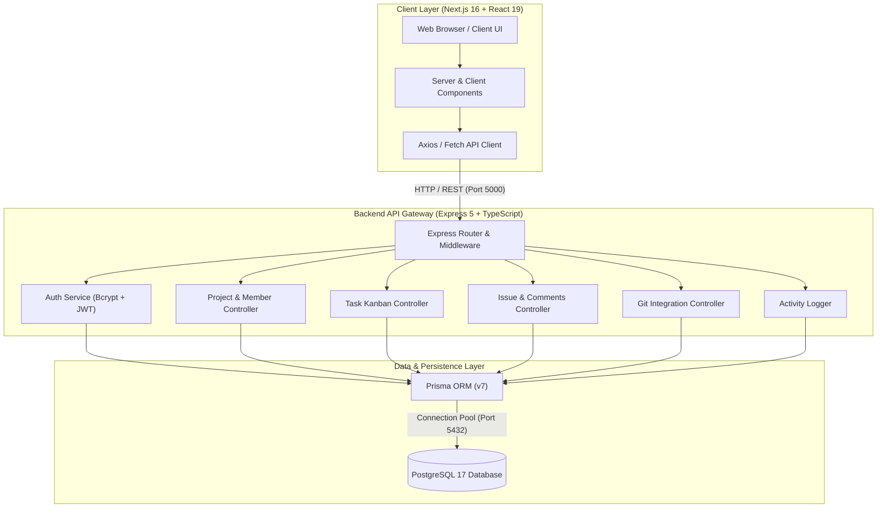
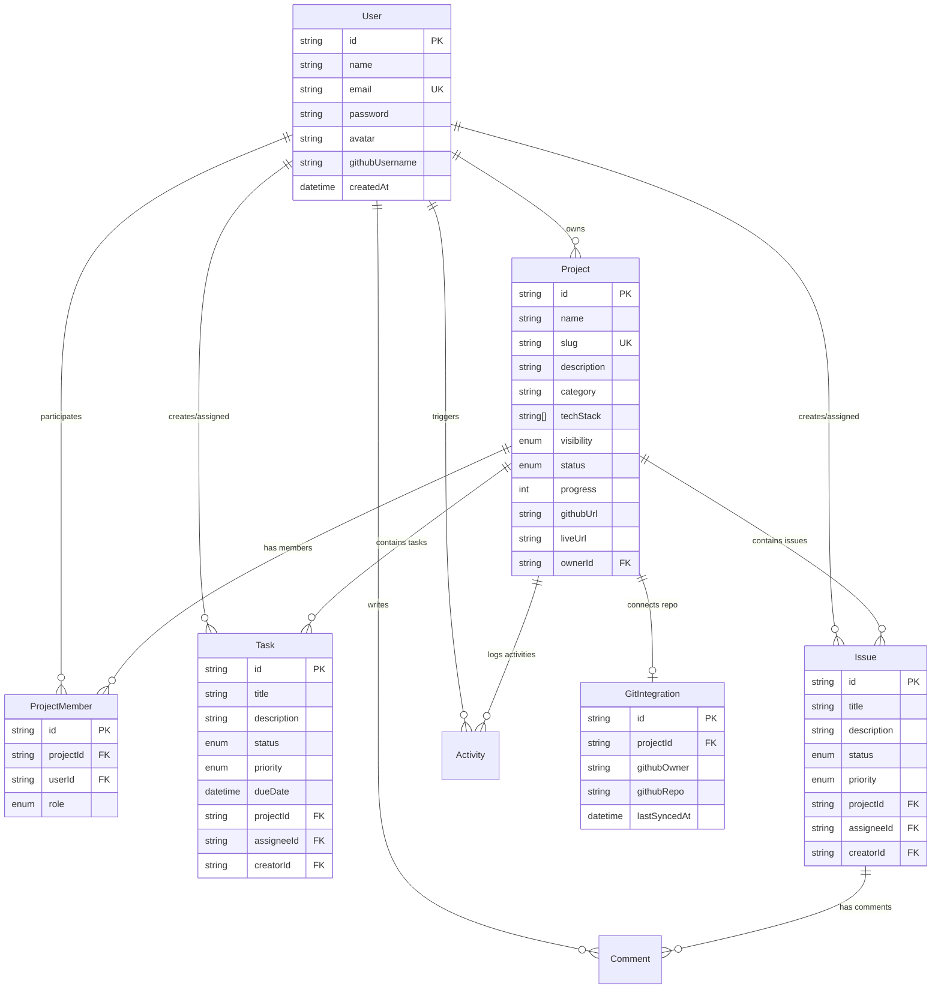

# DevFlow — Developer Collaboration & Workflow Platform

<div align="center">


**A modern, full-stack, containerized developer collaboration hub uniting project tracking, agile Kanban task management, issue resolution, GitHub synchronization, team access control, and project showcasing.**

[](https://nextjs.org/)
[](https://react.dev/)
[](https://www.typescriptlang.org/)
[](https://expressjs.com/)
[](https://www.postgresql.org/)
[](https://www.prisma.io/)
[](https://tailwindcss.com/)
[](https://www.docker.com/)
[](LICENSE)

[Architecture](#-system-architecture--how-it-functions) •
[Features](#-key-features) •
[Tech Stack](#-technology-stack--what-was-used) •
[Development Phases](#-development--implementation-phases) •
[Database Model](#-database-schema--data-model) •
[API Reference](#-api-endpoints-reference) •
[Quick Start](#-quick-start-guide)

</div>

---

## 📖 Executive Summary

**DevFlow** is an open-source, full-stack developer operations and team collaboration platform. Modern engineering teams often struggle with fragmented tooling—managing tasks in one tool, tracking bugs in another, monitoring repositories on GitHub, and maintaining external portfolios. 

DevFlow consolidates these fragmented workflows into a single, cohesive developer workspace:
- **Centralized Project Workspaces:** Track project lifecycles from initial planning to live production deployment.
- **Kanban Task Boards:** Agile task progression with priority tiers, assignees, and deadlines.
- **Integrated Issue Tracker:** Bug logging, triage, and threaded technical discussions.
- **GitHub Repository Sync:** Contextual git repository links and sync timestamps.
- **Granular RBAC:** Role-based membership permissions across team members.
- **Audit Activity Feed:** Chronological event timeline recording every update across the organization.
- **Community Showcase:** Public project gallery highlighting live applications, demos, and tech stacks.

---

## 🏗️ System Architecture & How It Functions

DevFlow is designed around a decoupled, three-tier micro-service architecture containerized with Docker and orchestrated via Docker Compose:



### Communication & Data Flow

1. **Browser to Frontend:** Users access the responsive Next.js frontend on `http://localhost:3000`. Next.js leverages Turbopack and React 19 for instantaneous hot-reloading and client-side page transitions.
2. **Browser to Backend API:** Browser requests to `/api/*` communicate directly with the Express 5 server on `http://localhost:5000`. CORS is configured to permit authenticated requests with JSON payloads.
3. **Backend to Database:** The Express server utilizes the Prisma ORM client with connection pooling to query the PostgreSQL 17 container via the internal Docker bridge network (`devflow-net`).
4. **Data Isolation & Security:** In production mode (`docker-compose.prod.yml`), PostgreSQL is strictly restricted to the internal network and never bound to host ports, protecting database integrity from external exposure.

---

## ✨ Key Features

| Feature | Description |
| :--- | :--- |
| **📊 Central Telemetry Dashboard** | Comprehensive overview of active projects, task completion rates, open issues, and real-time team activity streams. |
| **📁 Project Workspace Management** | Full CRUD capabilities for projects, slug generation, tech stack tagging, visibility toggles (`PUBLIC`, `TEAM`, `PRIVATE`), and deployment tracking. |
| **📌 Agile Task Board (Kanban)** | Interactive columns (`TODO`, `IN_PROGRESS`, `IN_REVIEW`, `DONE`) with priority badges (`LOW`, `MEDIUM`, `HIGH`, `URGENT`), target due dates, and assignee avatars. |
| **🐛 Issue Tracking & Discussions** | Dedicated bug and feature tracking with status flows (`OPEN`, `IN_PROGRESS`, `RESOLVED`, `CLOSED`) and threaded comment discussions. |
| **🐙 GitHub Integration** | Connect repositories (`owner/repo`), monitor sync timestamps, link GitHub usernames, and jump directly to source trees. |
| **👥 Role-Based Access Control (RBAC)** | Member assignment with designated organizational roles: `OWNER`, `ADMIN`, `DEVELOPER`, `DESIGNER`, and `VIEWER`. |
| **⚡ Live Activity & Audit Feed** | Automatic event logging capturing project creations, member additions, task movements, and issue closures. |
| **🌐 Public Project Showcase** | Community portal for showcasing completed projects, filtering by tech stacks, viewing demo videos, and accessing live URLs. |

---

## 💻 Technology Stack & What Was Used

### Frontend (Client)
- **Framework:** [Next.js 16.3](https://nextjs.org/) (App Router, Turbopack, Server-Side Rendering & Client Components)
- **Library:** [React 19.2](https://react.dev/)
- **Language:** [TypeScript 5.9](https://www.typescriptlang.org/)
- **Styling:** [Tailwind CSS v4](https://tailwindcss.com/)
- **Icons & UI Utilities:** Lucide React icons, CSS Grid/Flexbox responsive design
- **State & Networking:** React Hooks (`useState`, `useEffect`, `useCallback`), Native Fetch API

### Backend (Server)
- **Runtime & Framework:** [Node.js 22](https://nodejs.org/) & [Express 5.2](https://expressjs.com/)
- **Language:** [TypeScript 7.0](https://www.typescriptlang.org/) with [`tsx`](https://github.com/privatenumber/tsx) hot reload
- **ORM:** [Prisma 7.9](https://www.prisma.io/) with PostgreSQL adapter (`@prisma/adapter-pg`, `@prisma/client`)
- **Authentication & Security:** `bcryptjs` password hashing, CORS middleware
- **Configuration:** `dotenv` environment variable management

### Database & Infrastructure
- **Database:** [PostgreSQL 17](https://www.postgresql.org/)
- **Containerization:** [Docker](https://www.docker.com/) (Multi-stage builds: `base`, `dev`, `builder`, `production`)
- **Orchestration:** [Docker Compose](https://docs.docker.com/compose/) with automated healthchecks and dependency sequencing
- **Process & Entrypoint:** Custom shell entrypoint scripts (`docker-entrypoint.sh`) ensuring automated schema migration and Prisma client generation before server boot

---

## 🗄️ Database Schema & Data Model

The data layer is managed with **Prisma ORM** against PostgreSQL. The relational schema is structured as follows:



### Enumerations
- **`ProjectStatus`**: `PLANNING`, `IN_PROGRESS`, `BUILDING`, `IN_REVIEW`, `COMPLETED`, `LIVE`, `ARCHIVED`
- **`ProjectVisibility`**: `PRIVATE`, `TEAM`, `PUBLIC`
- **`TaskStatus`**: `TODO`, `IN_PROGRESS`, `IN_REVIEW`, `DONE`
- **`TaskPriority`**: `LOW`, `MEDIUM`, `HIGH`, `URGENT`
- **`IssueStatus`**: `OPEN`, `IN_PROGRESS`, `RESOLVED`, `CLOSED`
- **`MemberRole`**: `OWNER`, `ADMIN`, `DEVELOPER`, `DESIGNER`, `VIEWER`

---

## 🚀 Development & Implementation Phases

The project was architected and built in **6 deliberate phases**:

### Phase 1: Planning, Domain Modeling & Architectural Blueprint
- Defined the target user journey for software engineering teams.
- Designed the entity relationships (Users, Projects, Members, Tasks, Issues, Comments, Activity logs, Git integrations).
- Established the multi-tier containerized architecture separating Next.js, Express, and PostgreSQL.

### Phase 2: Database Schema & Migration Engine
- Configured PostgreSQL 17 with Prisma ORM 7.
- Authored declarative schema models with relational constraints (`onDelete: Cascade` / `SetNull`).
- Established migration pipelines and automated schema generation on boot via `docker-entrypoint.sh`.

### Phase 3: RESTful API Gateway & Backend Services
- Built modular Express 5 routers in TypeScript:
  - `/api/auth`: User registration, credential authentication, and profile endpoints.
  - `/api/projects`: Full CRUD, slug validation, statistics, and filtering.
  - `/api/tasks`: Kanban board management, status updates, priority sorting.
  - `/api/issues`: Issue reporting, resolution states, and threaded commenting.
  - `/api/git`: GitHub repository linking and sync metadata.
  - `/api/activity`: Audit logging recording project events and timestamps.
  - `/api/showcase`: Public discovery endpoints for verified projects.
- Added centralized error handling middleware and CORS validation.

### Phase 4: Frontend Architecture & Dashboard Interface
- Scaffolded Next.js 16 App Router application with React 19 and Tailwind CSS v4.
- Implemented modular dashboard sub-pages:
  - Overview Dashboard (`/dashboard`)
  - Project Management (`/dashboard/projects`)
  - Kanban Tasks Board (`/dashboard/tasks`)
  - Issue Tracker (`/dashboard/issues`)
  - GitHub Integration Hub (`/dashboard/git`)
  - Team & Role Permissions (`/dashboard/team`)
  - Live Activity Audit Log (`/dashboard/activity`)
  - Community Project Showcase (`/dashboard/showcase`)
- Integrated real-time feedback, responsive navigation sidebars, and status badges.

### Phase 5: Containerization, Orchestration & Multi-Stage Docker
- Authored optimized multi-stage Dockerfiles for both Client and Server:
  - `dev` stage: Live volume mounting, hot-reloading (`tsx watch` and `next dev`).
  - `builder` stage: Dependency minimization, asset compilation, and type generation.
  - `production` stage: Minimal slim node runtime executing standalone bundles.
- Configured Docker Compose network bridges (`devflow-net`) and dependent healthcheck startup sequencing (`condition: service_healthy`).

### Phase 6: Production Hardening, Security & Deployment Ready
- Implemented network segregation: PostgreSQL port is completely closed to the host network in production.
- Added strict environment separation via `.env.example` templates.
- Enforced clean Git repository tracking, comprehensive `.gitignore`, and artifact exclusion.

---

## 📡 API Endpoints Reference

### Health & System
| Method | Endpoint | Description |
| :--- | :--- | :--- |
| `GET` | `/api/health` | Healthcheck endpoint verifying API server status |

### Authentication
| Method | Endpoint | Description |
| :--- | :--- | :--- |
| `POST` | `/api/auth/register` | Register a new user account |
| `POST` | `/api/auth/login` | Authenticate user credentials |
| `GET` | `/api/auth/me` | Fetch authenticated user profile |

### Projects & Workspaces
| Method | Endpoint | Description |
| :--- | :--- | :--- |
| `GET` | `/api/projects` | List all projects (with filtering by status/visibility) |
| `POST` | `/api/projects` | Create a new project workspace |
| `GET` | `/api/projects/:id` | Fetch detailed project info by ID or slug |
| `PUT` | `/api/projects/:id` | Update project metadata, status, or progress |
| `DELETE` | `/api/projects/:id` | Delete project workspace (cascades tasks/issues) |
| `GET` | `/api/projects/:id/members` | List all members and roles of a project |
| `POST` | `/api/projects/:id/members` | Add a user to a project with a designated role |
| `DELETE` | `/api/projects/:id/members/:userId` | Remove member from project |

### Tasks (Kanban)
| Method | Endpoint | Description |
| :--- | :--- | :--- |
| `GET` | `/api/tasks` | Fetch tasks (filterable by `projectId`, `status`, `assigneeId`) |
| `POST` | `/api/tasks` | Create a new task |
| `PUT` | `/api/tasks/:id` | Update task status (`TODO`, `IN_PROGRESS`, `DONE`), priority, assignee |
| `DELETE` | `/api/tasks/:id` | Remove a task |

### Issues & Comments
| Method | Endpoint | Description |
| :--- | :--- | :--- |
| `GET` | `/api/issues` | List issues (filterable by project and status) |
| `POST` | `/api/issues` | Report a new issue |
| `PUT` | `/api/issues/:id` | Update issue state (`OPEN`, `RESOLVED`, `CLOSED`) |
| `POST` | `/api/issues/:id/comments` | Post a comment on an issue thread |

### Git Integration & Activity
| Method | Endpoint | Description |
| :--- | :--- | :--- |
| `POST` | `/api/git/connect` | Link a GitHub repository (`owner/repo`) to a project |
| `POST` | `/api/git/sync` | Trigger sync metadata update |
| `GET` | `/api/activity` | Retrieve recent chronological activity stream |
| `GET` | `/api/showcase` | List public showcase projects |

---

## ⚡ Quick Start Guide

### Prerequisites
- [Docker](https://docs.docker.com/get-docker/) & [Docker Compose](https://docs.docker.com/compose/) installed and running.
- Alternatively for local-only development: [Node.js 20+](https://nodejs.org/) and a local [PostgreSQL 17](https://www.postgresql.org/) instance.

---

### Method A: Running with Docker (Recommended)

#### 1. Clone & Configure Environment
```bash
git clone https://github.com/duamarkand/devflow.git
cd devflow

# Copy environment template
cp .env.example .env
```

#### 2. Start Development Containers
```bash
docker compose up -d --build
```

#### 3. Access Services
- **Next.js Web Client:** [http://localhost:3000](http://localhost:3000)
- **Express API Health:** [http://localhost:5000/api/health](http://localhost:5000/api/health)
- **PostgreSQL Database:** `localhost:5432`

#### 4. Monitor & Stop
```bash
# View live container logs
docker compose logs -f

# Stop containers (preserves database data)
docker compose down
```

---

### Method B: Running in Production Mode (Docker)

To run with compiled Next.js standalone assets, optimized Express builds, and private database networking:

```bash
docker compose -f docker-compose.prod.yml up -d --build
```

---

### Method C: Running Locally Without Docker

#### 1. Setup Database
Ensure PostgreSQL is running locally and create database `devflow`:
```bash
createdb devflow
```

#### 2. Start Backend API
```bash
cd server
cp .env.example .env
npm install
npx prisma generate
npx prisma migrate dev --name init
npm run dev
```
Backend will start on `http://localhost:5000`.

#### 3. Start Frontend Client
In a new terminal:
```bash
cd client
cp .env.example .env
npm install
npm run dev
```
Frontend will start on `http://localhost:3000`.

---

## 📂 Project Directory Structure

```
devflow/
├── .dockerignore                 # Global Docker ignore rules
├── .env.example                  # Environment variables template
├── .gitignore                    # Git tracking ignore rules
├── README.md                     # Comprehensive project documentation
├── docker-compose.yml            # Primary Docker Compose orchestration (dev)
├── docker-compose.dev.yml        # Development overrides
├── docker-compose.prod.yml       # Production-hardened orchestration
│
├── client/                       # Next.js 16 Frontend
│   ├── app/                      # App Router pages and layouts
│   │   ├── dashboard/            # Authenticated dashboard workspace
│   │   │   ├── activity/         # Real-time activity feed
│   │   │   ├── git/              # GitHub repository integration
│   │   │   ├── issues/           # Issue tracker & discussions
│   │   │   ├── projects/         # Project management
│   │   │   ├── settings/         # User and workspace preferences
│   │   │   ├── showcase/         # Public project showcase
│   │   │   ├── tasks/            # Kanban task board
│   │   │   └── team/             # Team & RBAC management
│   │   ├── login/                # Authentication - Login
│   │   ├── register/             # Authentication - Register
│   │   ├── globals.css           # Global Tailwind CSS styling
│   │   ├── layout.tsx            # Root layout wrapper
│   │   └── page.tsx              # Public landing page
│   ├── components/               # Reusable UI components
│   ├── lib/                      # API client and helper functions
│   ├── Dockerfile                # Multi-stage Dockerfile for Next.js
│   └── package.json              # Client dependencies
│
└── server/                       # Express 5 & Prisma Backend
    ├── prisma/                   # Prisma ORM
    │   ├── schema.prisma         # Database schema models & enums
    │   └── migrations/           # Versioned SQL migration files
    ├── src/                      # Source code
    │   ├── lib/                  # Prisma client instance singleton
    │   ├── middleware/           # Express authentication & validation middleware
    │   ├── routes/               # Modular REST API endpoints
    │   │   ├── activity.ts       # Audit and activity endpoints
    │   │   ├── auth.ts           # Authentication & user profile endpoints
    │   │   ├── git.ts            # GitHub integration endpoints
    │   │   ├── issues.ts         # Issue management & comments
    │   │   ├── members.ts        # Project member role endpoints
    │   │   ├── projects.ts       # Project CRUD & stats
    │   │   ├── showcase.ts       # Public showcase endpoints
    │   │   └── tasks.ts          # Kanban tasks endpoints
    │   └── index.ts              # Express application entrypoint
    ├── Dockerfile                # Multi-stage Dockerfile for Express
    ├── docker-entrypoint.sh      # Container boot migration & generation script
    └── package.json              # Server dependencies
```

---

## 🔮 Future Roadmap

- [ ] **Real-time Collaboration:** WebSockets / Socket.io for instantaneous task drag-and-drop sync across teammates.
- [ ] **GitHub Webhooks:** Automated task and issue resolution on `git push` or pull request merges.
- [ ] **OAuth2 & SSO:** GitHub and Google Single Sign-On authentication.
- [ ] **CI/CD Integration:** Automated build and preview deployments with GitHub Actions.
- [ ] **Notification Center:** In-app and email notifications for task assignments and issue mentions.

---

## 📄 License

This project is licensed under the [MIT License](LICENSE). Feel free to use, modify, and distribute it for personal and commercial projects.
